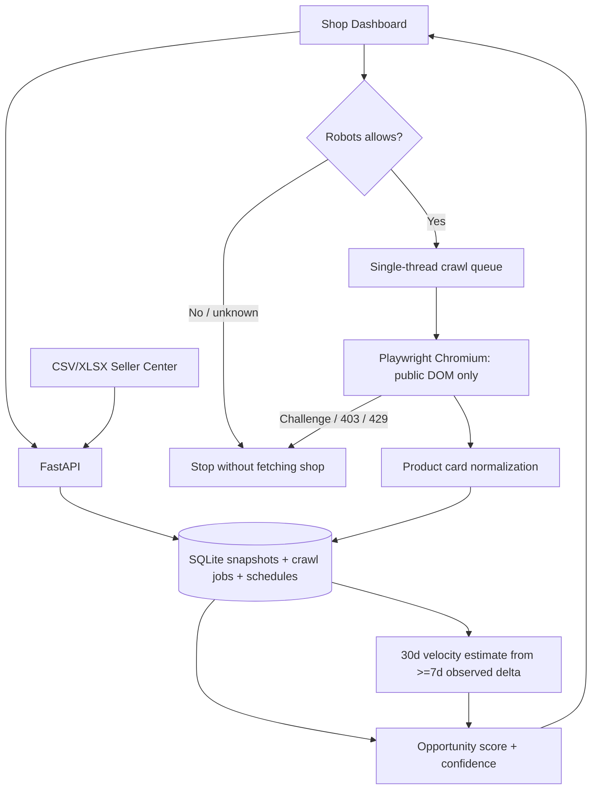

# MarketLens v0.2 — kiến trúc

## Production: Java/Spring Boot option

- Spring Boot API: workspace/tenants, crawler job creation, auth/RBAC, quota, audits.
- Python worker with Playwright; durable job broker Redis/Celery or RabbitMQ. One permissioned target <=1/24h.
- PostgreSQL: `shop`, `product`, `product_observation`, `crawl_job`, `crawl_target`, `consent_evidence`.
- Data fields: `source`, `observed_at`, `measurement_basis`, `coverage`, `is_estimate`, `confidence`.
- Canonical cross-shop matching (product names/images) after lawful access to data.
- Analytics: price changes, estimated 30d sales momentum, price opportunity, gross/contribution margin, top items, category mix.
- Observability: metrics, robot-policy status, blocked challenges, alert on parsing regressions.
- Compliance: platform written permission plus robots restrictions, no login scraping, no circumventing barriers, privacy minimization.

## Why two snapshots?

Cumulative units at t0=200 and t1=242 fourteen days later gives **estimated** `42 × 30 / 14 = 90 units per 30d` assuming constant pace. The true most recent 30-day volume could be very different. When only one observation exists, display cumulative units separately and rank as **provisional** (very-low confidence); never label cumulative sold as sales last 30 days.

This implementation uses in-process threads and local database to keep MVP simple, not suitable for multiple replicas or Internet-facing use.
